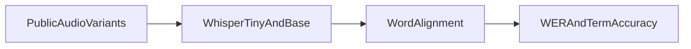

1. WER plus domain-term accuracy (e.g. medical terms) on public audio. Shows where general WER hides the failures that matter.

2. Result:
   Open ASR models compared: 2  
   Public audio variants per model: 3  
   Aligned term occurrences evaluated: 18  

   Measured with `make bench`: [raw results](evidence/bench.json), [command output](evidence/checks.log), [environment](evidence/environment.json).

3. Architecture:


4. Run it:
```sh
make setup
make lint test bench
make demo
```

5. Decisions and limits: Two real open ASR models on one public JFK speech clip with clean, noisy and quiet variants. Civic-domain terms are explicitly fellow americans and country; this is not a medical-ASR evaluation. Metrics count aligned term occurrences rather than presence anywhere in the transcript. The report in evidence/report.md compares every WER/term-accuracy pair. Perturbed versions are not independent speakers, and the small sample cannot rank model quality generally. Ground-truth transcript and term list are committed; source is the public openai/whisper test clip.

6. Next: Add a licensed multi-speaker domain corpus and independently reviewed terminology annotations.
